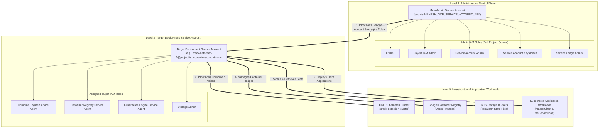
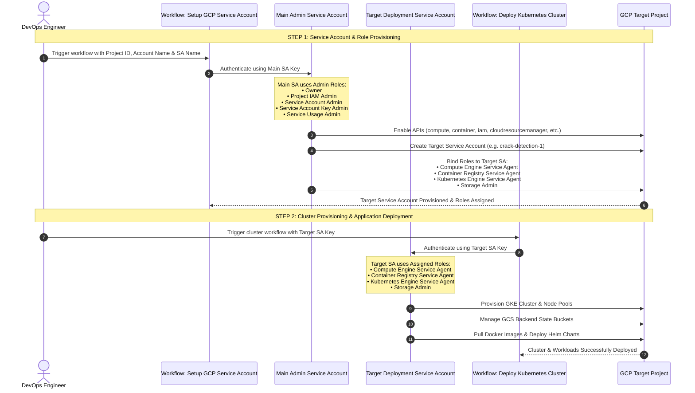

# GCP Service Account Architecture & Provisioning Hierarchy

This document provides a clear, full-name architectural layout and sequence flow for GCP Service Account role delegation and infrastructure provisioning.

---

## 1. Service Account Hierarchy & Role Delegation Diagram

---

## 2. End-to-End Workflow Execution Sequence

---

## 3. Role Breakdown & Purpose Matrix

### **Level 1: Main Admin Service Account**
Used by **`setup-gcp-service-account.yaml`** to perform administrative bootstrap operations.

| Full Role Display Name | GCP Technical Identifier | Purpose & Access Scope |
| :--- | :--- | :--- |
| **Owner** | `roles/owner` | Provides full access to all project resources. |
| **Project IAM Admin** | `roles/resourcemanager.projectIamAdmin` | Allows assigning and managing IAM role bindings for created service accounts. |
| **Service Account Admin** | `roles/iam.serviceAccountAdmin` | Allows creating, deleting, and managing custom Service Accounts. |
| **Service Account Key Admin** | `roles/iam.serviceAccountKeyAdmin` | Allows creating and managing Service Account JSON credential keys. |
| **Service Usage Admin** | `roles/serviceusage.serviceUsageAdmin` | Allows enabling required Google Cloud APIs (`compute`, `container`, `iam`, etc.). |

---

### **Level 2: Target Deployment Service Account**
Created dynamically (e.g., `crack-detection-1`, `crack-detection-3`) and used by **`deploy-kubernetes-cluster.yaml`** for routine infrastructure provisioning and app deployment.

| Full Role Display Name | GCP Technical Identifier | Purpose & Access Scope |
| :--- | :--- | :--- |
| **Compute Engine Service Agent** | `roles/compute.serviceAgent` | Allows managing Virtual Machines, VPC networks, firewalls, and load balancers for GKE nodes. |
| **Container Registry Service Agent** | `roles/containerregistry.ServiceAgent` | Allows storing, pulling, and pushing Docker container images. |
| **Kubernetes Engine Service Agent** | `roles/container.serviceAgent` | Allows GKE control plane operations to manage Kubernetes cluster nodes and workloads. |
| **Storage Admin** | `roles/storage.admin` | Full control over Google Cloud Storage (GCS) buckets used for Terraform backend state files. |
